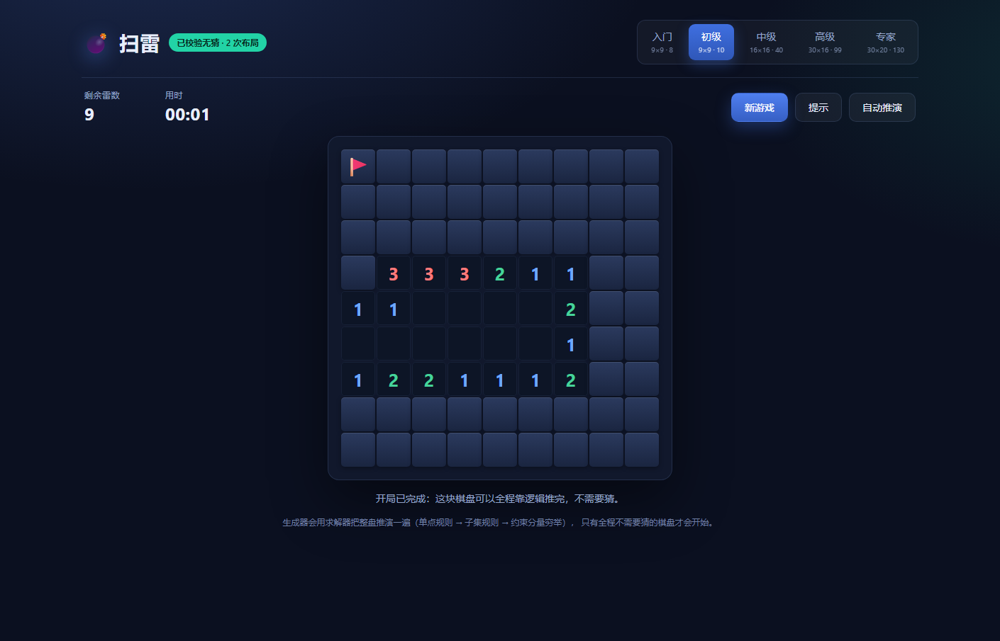

# 扫雷 · 无猜模式（Minesweeper No Guess）

一个**保证不需要猜测**的扫雷游戏：每一局棋盘在开始前都会用求解器完整推演，只有能纯逻辑通关的棋盘才会开始。



## 下载

到 [Releases](../../releases) 下载 `Minesweeper-NoGuess-1.0.0.exe`，双击即玩。

- Windows 10/11 x64，单文件约 1 MB，免安装；
- 依赖系统自带的 **WebView2 Runtime**（Win11 自带；Win10 若缺失会提示，可从微软官网安装）。

也可以直接用网页版：打开 `index.html` 即可。

## 玩法

| 操作 | 效果 |
| --- | --- |
| 左键未翻开格 | 翻开 |
| 右键未翻开格 | 插旗 / 取消 |
| 左键已翻开数字 | 快速排雷（旗数等于数字时翻开周围） |
| 触屏长按 | 插旗 |

五档难度：入门 9×9/8、初级 9×9/10、中级 16×16/40、高级 30×16/99、专家 30×20/130。

- **提示**：高亮一个可以推导出来的安全格或雷格；
- **自动推演**：只用逻辑把整盘走完，用来证明这局确实不需要猜。

## 为什么不需要猜

生成棋盘后，求解器从第一次点击的 3×3 开局开始模拟通关：

1. **单点规则**：数字 = 周围未翻开格数 → 全是雷；数字 = 已插旗数 → 其余全安全；
2. **子集规则**：两个约束的格子集合存在包含关系时，差集可直接判定；
3. **连通分量穷举**：把互相牵连的约束分组，枚举所有合法布雷方式，找出在所有方案中必然是雷 / 必然是安全的格子。

只要出现一步推不动，这个棋盘就作废重来。因此每一步都存在可推导的走法。

## 项目结构

```
├── index.html / style.css / game.js   游戏本体（纯前端，可直接双击）
├── native/
│   ├── app.cs                         Windows 桌面壳（WinForms + WebView2）
│   └── build.ps1                      打包脚本（csc + WebView2 SDK）
├── build/icon.ico                     应用图标
├── tests/                             Node 测试脚本
└── screenshots/                       预览图
```

## 构建 Windows exe

需要：
- Windows 自带的 .NET Framework 4.x（`csc.exe`）；
- [Microsoft.Web.WebView2](https://www.nuget.org/packages/Microsoft.Web.WebView2) NuGet 包（脚本会自动下载）。

```powershell
powershell -ExecutionPolicy Bypass -File native/build.ps1
```

产物在 `native/MinesweeperNoGuess.exe`，单文件，运行时把 `WebView2Loader.dll` 释放到同级目录（无写入权限时回退到临时目录）。

## 测试

```bash
node tests/test_core.js      # 校验生成器：雷数、首击安全、无猜可解
node tests/test_levels.js    # 五档难度生成成功率与耗时
```

## 技术

- 游戏本体：原生 HTML / CSS / JavaScript，无框架、无依赖；
- 桌面壳：C# WinForms + WebView2，把 HTML/CSS/JS 内联后交给 WebView2 渲染；
- 求解器思路参考 [JSMinesweeper](https://github.com/DavidNHill/JSMinesweeper)（MIT）。

## License

MIT
